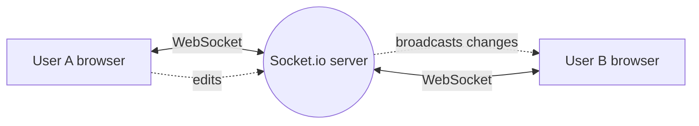

<div align="center">

<picture>
  <source media="(prefers-color-scheme: dark)" srcset="https://capsule-render.vercel.app/api?type=venom&color=0:E53945,100:0d1117&height=240&section=header&text=Kunal%20Ahire&fontSize=64&fontColor=ffffff&animation=twinkling&fontAlignY=38&desc=Gen%20AI%20%2F%20LLM%20Engineer%20%C2%B7%20Full%20Stack%20Developer&descAlignY=60&descSize=20">
  
</picture>

<a href="https://kunal-ahire.netlify.app/"></a>

<br/><br/>

<a href="https://kunal-ahire.netlify.app/"></a>
<a href="https://linkedin.com/in/kunal-ahire-95529a230"></a>
<a href="mailto:kunalahire590@gmail.com"></a>

<br/><br/>


</div>

<br/>

## ⚡ TL;DR (for recruiters)

| | |
|---|---|
| 🎓 **Education** | B.E. Computer Engineering, PVGCOEN Nashik (SPPU) · 2023–2027 · CGPA 7.59 |
| 💼 **Experience** | Gen AI LLM Engineer @ CodeFeast · Software Design & Dev Intern @ Seema Technologies · Freelance Web Developer (10+ sites) |
| 🧰 **Strongest at** | Python · LLMs · Prompt Engineering · React · Next.js · Node.js · TypeScript · Supabase |
| 🚀 **Built** | Code-PVG, a coding platform for **500+ students** · Codexia, a real-time collaborative code editor |
| 🏆 **Leadership** | ML Campus Lead · Tech Head, SkillUp Club (mentoring **50+ students**) · Tech Head, Team Night Fury |
| 📬 **Status** | 🟢 **Open to Gen AI / LLM Engineer opportunities** |

<br/>

## 🧑‍💻 About Me

I'm a Gen AI / LLM Engineer and full-stack developer who can take an LLM feature from **prototype to a working application** with a frontend, backend and database. I've built Generative AI solutions in Python using prompt engineering and Tau-Bench, and shipped full-stack products used by hundreds of students.

```ts
const kunal = {
  role:       "Gen AI / LLM Engineer · Full Stack Developer",
  education:  "B.E. Computer Engineering, PVGCOEN (2023–2027)",
  genAI:      ["LLMs", "Prompt Engineering", "Tau-Bench", "Generative AI solutions"],
  fullStack:  ["React", "Next.js", "Node.js", "Express", "TypeScript", "Supabase"],
  strongIn:   ["DSA", "OOP", "SQL", "REST APIs"],
  leading:    ["ML Campus Lead", "SkillUp Club Tech Head", "Team Night Fury Tech Head"],
  lookingFor: "a Gen AI / LLM Engineer opportunity",
};
```

<br/>

## 💼 Experience

| Role | Where | What I did |
|---|---|---|
| 🤖 **Gen AI LLM Engineer** · 4 months | CodeFeast | Developed Generative AI solutions with LLMs for intelligent applications · applied prompt engineering and Tau-Bench while building LLM-powered features · *Python* |
| 💻 **Software Design & Development Intern** · 1.5 months | Seema Technologies | Built responsive UIs with React.js and Bootstrap, designed in Figma |
| 🌐 **Freelance Web Developer** | Self-employed | Delivered **10+ responsive websites** for local businesses, covering requirements gathering through deployment |

## 🧭 Leadership

| Role | What I do |
|---|---|
| 🧠 **ML Campus Lead** | Run machine learning workshops and study groups to promote AI/ML education |
| 👨‍💻 **Tech Head, SkillUp Club (PVGCOEN)** | Organise coding workshops and mentor **50+ students** in web development and programming |
| 🏎️ **Tech Head, Team Night Fury (Go-Kart)** · *Jul 2026 – Present* | Lead the technical team across engineering, sensor integration and documentation · *IoT, Arduino, embedded systems, CAD* |
| 🏅 **Sports Secretary, PVGCOEN** | Elected to organise college-level sports events and inter-departmental competitions |

<br/>

## 🚀 Featured Projects

<table>
<tr>
<td width="50%" valign="top">

### 🧠 Code-PVG
**Competitive coding platform** · *2025–2026*

Built for **500+ students**: problem sets, code submissions and a ranking system. Includes user authentication, a secure code execution engine and a real-time leaderboard.


</td>
<td width="50%" valign="top">

### 🧩 Codexia
**Real-time collaborative code editor** · *2026*

Instant synchronisation across clients with Socket.io and WebSockets, plus syntax highlighting and an integrated terminal view.


</td>
</tr>
</table>

<details>
<summary><b>📦 More projects</b></summary>
<br/>

- 🍽️ **Smart Canteen**: online pre-ordering with token-based queue management (React, Supabase)
- 💱 **Currency Converter**: real-time currency conversion (React, TypeScript)
- 🏟️ **Turf Management**: turf booking and management system (PHP, MySQL)

</details>

<details>
<summary><b>🔍 How Codexia works (simplified)</b></summary>



</details>

📂 More on my **[Portfolio](https://kunal-ahire.netlify.app/)**.

<br/>

## 🛠️ Tech Arsenal

<div align="center">

<picture>
  <source media="(prefers-color-scheme: light)" srcset="https://skillicons.dev/icons?i=python,js,ts,java,cpp,react,nextjs,nodejs,express,tailwind,postgres,mysql,supabase,firebase,git,figma&theme=light&perline=16">
  
</picture>

</div>

| Area | Technologies |
|---|---|
| **Generative AI & ML** | Large Language Models (LLMs) · Generative AI · Prompt Engineering · Tau-Bench · Machine Learning |
| **Languages** | Python · JavaScript · TypeScript · Java · C++ · SQL · HTML5 · CSS3 |
| **Backend** | Node.js · Express.js · RESTful APIs · Socket.io · WebSockets · Authentication |
| **Frontend** | React.js · Next.js · Tailwind CSS · Bootstrap · Responsive Design |
| **Databases** | PostgreSQL · MySQL · Supabase · Firebase |
| **Tools** | Git · GitHub · Vercel · Netlify · npm · Figma |
| **Core concepts** | Data Structures & Algorithms · OOP · Database Management · Debugging · Problem Solving |

<br/>

## 🏆 Achievements

| | Achievement |
|---|---|
| 🥉 | **AIR 3**, FMAE Dirt Kart Design Challenge |
| 🏎️ | **AIR 11**, Hindustan Formula Karting Championship |
| 🏅 | **Best Placement Ready Team**, Culling Games |

<br/>

## 📊 GitHub Activity

<div align="center">


<br/><br/>

<picture>
  <source media="(prefers-color-scheme: dark)" srcset="https://raw.githubusercontent.com/developerskull/developerskull/output/github-snake-dark.svg">
  
</picture>

</div>

<br/>

## 🎓 Education

| | |
|---|---|
| **B.E. Computer Engineering** | Pune Vidyarthi Griha's College of Engineering, Nashik (SPPU) · 2023–2027 · CGPA 7.59 |
| **HSC (Science)** | K.A.A.N.M.M.S, Satana · 2023 · 63.43% |
| **SSC** | Kilbil English Medium School, Satana · 2021 · 82.63% |

<br/>

## 🤝 Let's Connect

Looking for a **Gen AI / LLM Engineer** who can also ship the full-stack app around the model? Let's talk.

<div align="center">

<a href="mailto:kunalahire590@gmail.com"></a>
<a href="https://linkedin.com/in/kunal-ahire-95529a230"></a>
<a href="https://kunal-ahire.netlify.app/"></a>

<br/><br/>

*"Building intelligent solutions, one line of code at a time."*


</div>
